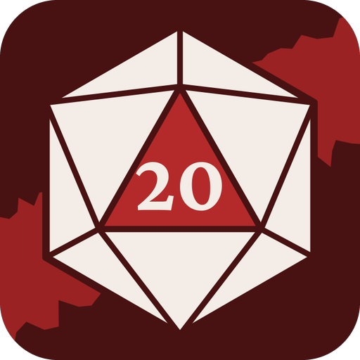

<p align="center">
  
</p>

# T20 Ficha

Ficha de personagem para **Tormenta 20 — Edição Jogo do Ano**, feita para Android.

O app calcula sozinho os valores da ficha (perícias, Defesa, PV, PM, ataques, carga, CD de magia) e **explica de onde vem cada número**: tocar na Defesa mostra a soma de base, Destreza, armadura e cada bônus, com o nome de quem concedeu. As regras seguem o livro, com a página anotada no código.

> Projeto de fã, não oficial. Veja o [aviso legal](#aviso-legal).

## Funcionalidades

**Ficha**
- Nome, atributos, PV e PM sempre visíveis, com botões para gastar e recuperar durante a sessão.
- Seções recolhíveis: Combate, Perícias, Magias, Habilidades e poderes, Equipamento e Anotações, cada uma com um resumo (ex.: "Defesa 13", "6 de 14 espaços").
- Toque em qualquer valor calculado para ver a explicação do cálculo. Bônus que só valem em certas situações (como a Armadura de Allihanna) aparecem separados, fora do total.

**Rolagens**
- Aba **Dados** na ficha, com dados em 3D (d4, d6, d8, d10, d12, d20 e d100) lançados numa bandeja de feltro: quicam com sombra no chão e param com o resultado de frente, com vibração. Rolagens com vários dados lançam todos juntos. No 20 natural, um brilho rápido.
- Rolagens rápidas de perícias, atributos, ataques e dano, já com os bônus da ficha; o botão **Rolar** também aparece ao tocar numa perícia ou num ataque.
- Regras do livro: 20 natural é sucesso automático e 1 natural é falha automática; no ataque, a margem de ameaça da arma indica crítico, e o dano crítico multiplica só os dados, não os bônus.
- Dados livres (d4 a d100, com quantidade e modificador) e histórico das rolagens da sessão.

**Edição**
- Todos os campos da ficha, com bônus nomeados (ex.: "Vitalidade +2 em Fortitude"), bônus situacionais e bônus que crescem com o nível.
- **Regras de criação aplicadas na edição:**
  - Atributos por compra de pontos (com contador dos 10 pontos), por rolagem ou digitando o valor final; os ajustes de raça entram sozinhos (um lefou já começa com Carisma –1) e as escolhas de +1 respeitam as restrições da raça.
  - Perícias divididas por origem do treinamento (classe, origem, raça, Inteligência e outras fontes), com as que não podem ser escolhidas bloqueadas e o motivo indicado.
  - As 20 divindades do panteão, com bloqueio de quem não pode ser devoto, resumo das obrigações e escolha dos poderes concedidos (dois para druidas).
  - Poderes de origem e habilidades de classe por nível, adicionados e removidos automaticamente, com os bônus que o app sabe calcular.
  - Poderes de classe das cinco classes (mais de 100), com limite por nível e pré-requisitos conferidos pelo app: atributos, nível, outros poderes, perícias treinadas, caminho do arcanista e magias conhecidas.
- Catálogo do livro para preencher a ficha com poucos toques:
  - **Classes:** Arcanista (com os caminhos Bruxo, Feiticeiro e Mago), Bardo, Bucaneiro, Druida e Guerreiro. Preenche PV, PM, atributo de magia e perícias fixas.
  - **Raças:** Dahllan, Elfo, Humano, Lefou e Qareen. Adiciona habilidades, deslocamento e bônus.
  - **Origens:** Artista, Assistente de Laboratório, Marujo, Selvagem e Soldado.
  - **Magias de 1º e 2º círculos** (100), já filtradas pelo que o personagem pode aprender: tipo (arcana ou divina), escolas escolhidas e círculo liberado pelo nível.
  - **Armas** (40), **armaduras e escudos** (12) e **itens gerais** (mais de 100), com dano, crítico, alcance, preço e espaços.

**Fichas**
- Várias fichas salvas no celular, com lista na tela inicial.
- Salvamento automático do estado de jogo (PV e PM gastos).
- Modo claro e escuro.
- Layout adaptável: em tablets e dobráveis abertos, a ficha se divide em duas colunas (o essencial à esquerda, as seções à direita) e se reorganiza na hora ao abrir ou fechar o aparelho.

## Arquitetura

O projeto tem dois módulos, separando as regras da interface:

```
┌─────────────────────────────┐
│ app  (Android, Compose)     │  telas, navegação, salvamento
└──────────────┬──────────────┘
               │ depende de
┌──────────────▼──────────────┐
│ rules  (Kotlin puro)        │  motor de regras, catálogo, formato de arquivo
└─────────────────────────────┘
```

- **`rules`** não depende do Android, então é testado em segundos, sem emulador. Todo valor calculado é um `DerivedValue`: o total mais a lista de parcelas que o compõem, que é o que alimenta as explicações da ficha.
- **`app`** usa Jetpack Compose com Material 3. Cada ficha é salva como um arquivo JSON no armazenamento interno do app, por meio de um repositório; trocar por um banco de dados no futuro não afeta as telas.

### Principais arquivos

| Módulo | Arquivo | O que faz |
|---|---|---|
| rules | `Sheet.kt` | A ficha preenchida pelo jogador (`ManualSheet`) |
| rules | `SheetEngine.kt` | As contas do livro aplicadas à ficha, com explicação |
| rules | `Catalog.kt` | Magias, armas, armaduras, itens, classes, raças e origens |
| rules | `ClassPowers.kt` | Poderes de classe e seus pré-requisitos |
| rules | `CatalogPowers.kt` | Divindades, poderes concedidos e de origem, habilidades de classe |
| rules | `CatalogApply.kt` | Aplica raça, classe, origem, devoção e poderes; regras de atributos e perícias |
| rules | `DiceModels.kt` | Geometria dos dados (d4 a d20) numerados como dados físicos |
| rules | `Dice.kt` | Fórmulas de dados, rolagens, crítico e rolagens prontas da ficha |
| rules | `SheetCodec.kt`, `Json.kt` | Conversão da ficha para JSON e de volta |
| rules | `RuleEngine.kt`, `Validator.kt` | Motor automático completo (usado nos testes de validação) |
| app | `ui/sheet/SheetScreen.kt` | Tela da ficha |
| app | `ui/dice/DiceTab.kt` | Aba de rolagens e histórico |
| app | `ui/dice/DiceTray.kt` | Bandeja com os dados em 3D |
| app | `ui/edit/` | Edição e escolha no catálogo |
| app | `ui/list/SheetListScreen.kt` | Lista de fichas |
| app | `data/SheetRepository.kt` | Salvamento das fichas |
| app | `ui/theme/` | Tema, fontes e a borda rasgada |

## Como rodar

**Requisitos:** Android Studio (versão recente) e um celular Android ou o emulador. O Android Studio já inclui o JDK, o Kotlin e o Gradle.

1. Clone o repositório e abra a pasta no Android Studio.
2. Espere a sincronização do Gradle terminar.
3. Selecione a configuração `app` e clique em **Run**.

Na primeira abertura, o app já vem com uma ficha de exemplo.

## Testes

Os testes ficam no módulo `rules` e conferem as regras contra o livro, usando como caso real a ficha de uma personagem da mesa (uma druida dahllan de 3º nível):

```bash
./gradlew :rules:test
```

Ou, no Android Studio, clique com o botão direito em `rules/src/test/java` e escolha **Run Tests**.

## Próximos passos

- [ ] Exportar e importar fichas
- [ ] Assistente de regras com IA, que consulta o livro (RAG) e sempre cita a página

## Aviso legal

Este é um projeto de fã, sem fins lucrativos, **sem qualquer vínculo com a Jambô Editora**. *Tormenta* e *Tormenta 20* são marcas de seus respectivos donos.

O app **não reproduz o texto do livro**. Ele contém apenas dados de regras (números como dano, custo e alcance), referências de página e resumos curtos escritos para o app. Para as regras completas, é preciso ter o livro *Tormenta 20 — Edição Jogo do Ano*.

As fontes usadas na interface são livres e distribuídas sob a SIL Open Font License; os textos das licenças estão na pasta [`licenses/`](licenses/):

- [Cinzel](https://fonts.google.com/specimen/Cinzel), de Natanael Gama
- [Crimson Pro](https://fonts.google.com/specimen/Crimson+Pro), de Jacques Le Bailly
- [Source Sans 3](https://fonts.google.com/specimen/Source+Sans+3), da Adobe

## Licença

O código ainda não tem uma licença definida.
